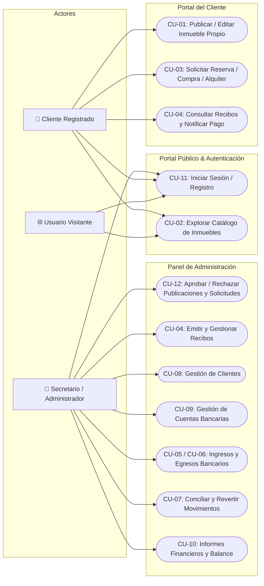
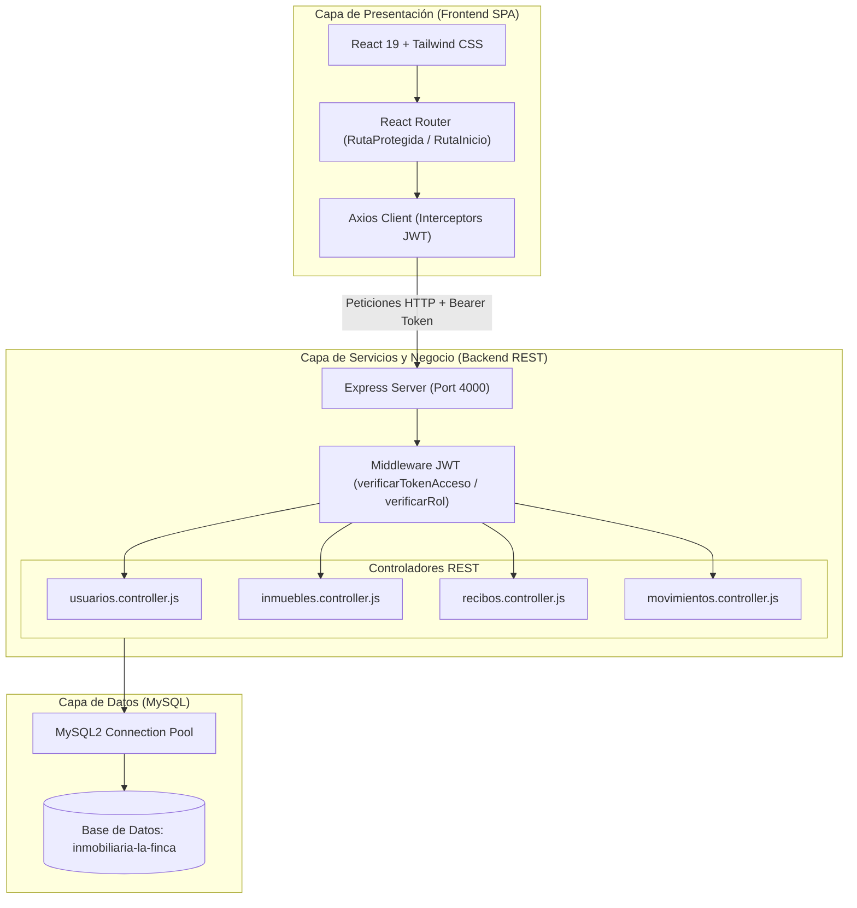
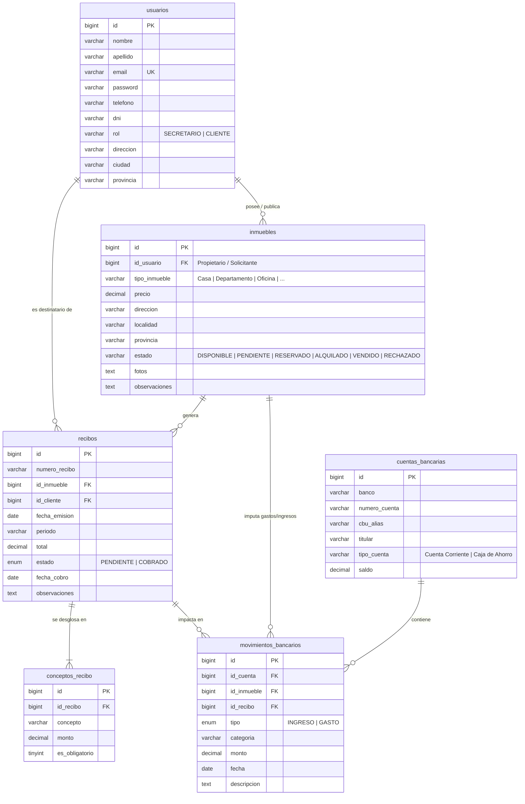
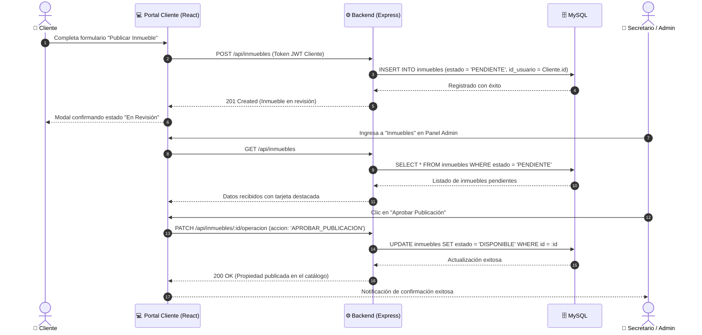
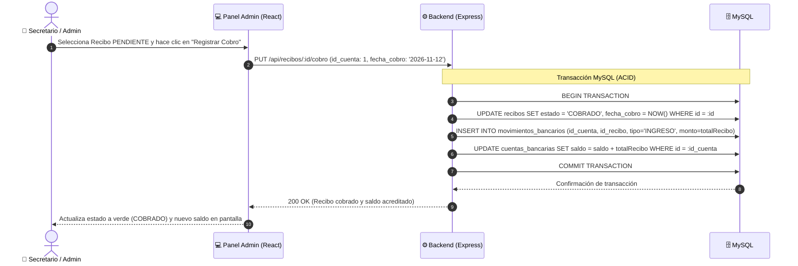

# Inmobiliaria La Finca 🏡

> **Sistema Integral de Gestión Inmobiliaria, Cobros, Movimientos Bancarios y Portal de Clientes.**  
> Aplicación web fullstack desarrollada para digitalizar la operativa comercial, contable y administrativa de una inmobiliaria moderna, con doble interfaz especializada para **Administradores** y **Clientes**.

---

## 📑 Tabla de Contenidos
1. [Descripción General](#-descripción-general)
2. [Arquitectura del Sistema](#-arquitectura-del-sistema)
3. [Casos de Uso del Sistema (CU)](#-casos-de-uso-del-sistema-cu)
4. [Diagramas del Sistema](#-diagramas-del-sistema)
   - [Diagrama de Casos de Uso](#diagrama-de-casos-de-uso)
   - [Diagrama de Arquitectura de la Aplicación](#diagrama-de-arquitectura-de-la-aplicación)
   - [Diagrama de Entidad-Relación (DER)](#diagrama-de-entidad-relación-der)
   - [Diagrama de Secuencia: Publicación y Aprobación de Inmuebles](#diagrama-de-secuencia-publicación-y-aprobación-de-inmuebles)
   - [Diagrama de Secuencia: Cobro de Recibo y Movimiento Bancario](#diagrama-de-secuencia-cobro-de-recibo-y-movimiento-bancario)
5. [Módulos Principales](#-módulos-principales)
6. [Stack Tecnológico](#-stack-tecnológico)
7. [Estructura del Proyecto](#-estructura-del-proyecto)
8. [Documentación de la API REST](#-documentación-de-la-api-rest)
9. [Instalación y Puesta en Marcha](#-instalación-y-puesta-en-marcha)
10. [Usuarios y Credenciales de Prueba](#-usuarios-y-credenciales-de-prueba)
11. [Buenas Prácticas y Seguridad](#-buenas-prácticas-y-seguridad)

---

## 📖 Descripción General

**Inmobiliaria La Finca** resuelve de punta a punta el ciclo operativo de bienes raíces:
- **Gestión Inmobiliaria**: Catálogo de propiedades (casas, departamentos, oficinas, chalets, dúplex), administración de estados (`DISPONIBLE`, `PENDIENTE`, `RESERVADO`, `ALQUILADO`, `VENDIDO`, `RECHAZADO`).
- **Circuito de Aprobación**: Los clientes pueden publicar sus propiedades para venta o alquiler; estas ingresan en estado `PENDIENTE` para que el administrador las evalúe, apruebe o rechace.
- **Facturación y Recibos (CU-04 / RF-14)**: Emisión discriminada de conceptos (Alquiler mensual, Expensas, Servicios, Seña de Boleto), generación de PDFs listos para imprimir y registro del estado de cobro.
- **Tesorería y Movimientos Bancarios (CU-05 / CU-06 / CU-07)**: Registro y conciliación de ingresos y egresos, múltiples cuentas bancarias con saldo en tiempo real, reversión de operaciones y balances financieros.
- **Gestión de Clientes (RF-01 / RF-02)**: Padrón completo de inquilinos, propietarios y compradores con historial de recibos e inmuebles vinculados.

---

## 🏛 Arquitectura del Sistema

La solución adopta una arquitectura cliente-servidor desacoplada (**SPA + REST API**):
- **Frontend SPA**: React 19 con enrutador dinámico (`react-router-dom`), Tailwind CSS para un diseño corporativo responsivo con modo claro/oscuro y Axios configurado con interceptores JWT.
- **Backend API REST**: Node.js con Express, arquitectura por capas (Rutas, Controladores, Middlewares de autenticación y Pool de conexiones).
- **Base de Datos**: MySQL relacional con soporte de integridad referencial, transacciones ACID para cobros/reversiones y claves foráneas.

---

## 🎯 Casos de Uso del Sistema (CU)

| Caso de Uso | Denominación | Actor Principal | Descripción |
| :--- | :--- | :--- | :--- |
| **CU-01** | **Publicar Inmueble** | Cliente / Secretario | Registro de una propiedad. Si la registra un cliente, pasa a estado `PENDIENTE` hasta ser validada por un administrador. |
| **CU-02** | **Búsqueda y Filtro de Inmuebles** | Público / Cliente / Admin | Exploración del catálogo según tipo de propiedad, localidad, rango de precio y disponibilidad. |
| **CU-03** | **Solicitud de Reserva / Alquiler / Compra** | Cliente | El cliente solicita alquilar o comprar una propiedad disponible, ingresando monto de seña o garantía y pasando el inmueble a `RESERVADO`. |
| **CU-04** | **Emisión y Consulta de Recibos** | Secretario / Cliente | Generación de recibos con detalle de conceptos (Alquiler, expensas, luz, agua). El cliente puede visualizarlos y descargarlos desde su portal. |
| **CU-05** | **Registro de Ingresos Bancarios** | Secretario | Ingreso de dinero a una cuenta bancaria (cobro de recibos, señas de compra, comisiones inmobiliarias) con actualización inmediata del saldo. |
| **CU-06** | **Registro de Egresos / Gastos** | Secretario | Asignación de gastos operativos, mantenimiento o servicios a cuentas bancarias y/o inmuebles específicos. |
| **CU-07** | **Conciliación de Movimientos** | Secretario | Asociación de movimientos financieros a un inmueble y a un recibo emitido. Permite revertir transacciones recalculando el saldo bancario. |
| **CU-08** | **Gestión Integral de Clientes** | Secretario | Alta, modificación, baja lógica/física y consulta de legajo de clientes (inquilinos, propietarios, compradores). |
| **CU-09** | **Gestión de Cuentas Bancarias** | Secretario | Alta, modificación, eliminación y seguimiento de saldos disponibles de cuentas corrientes y cajas de ahorro de la inmobiliaria. |
| **CU-10** | **Reportes y Balances Financieros** | Secretario | Métricas consolidadas del ejercicio: balance neto, desglose de ingresos vs. gastos por período y recaudación por inmueble. |
| **CU-11** | **Autenticación y Control de Acceso** | Todos los Usuarios | Inicio de sesión con credenciales seguras, generación de token JWT y redirección estricta según el rol (`SECRETARIO` al Panel Admin, `CLIENTE` al Portal Cliente). |
| **CU-12** | **Revisión y Aprobación Administrativa** | Secretario | El administrador revisa solicitudes de publicación, compra o alquiler, emitiendo automáticamente los recibos de seña o boleto correspondientes. |

---

## 📊 Diagramas del Sistema

### Diagrama de Casos de Uso


---

### Diagrama de Arquitectura de la Aplicación


---

### Diagrama de Entidad-Relación (DER)


---

### Diagrama de Secuencia: Publicación y Aprobación de Inmuebles


---

### Diagrama de Secuencia: Cobro de Recibo y Movimiento Bancario


---

## 💻 Módulos Principales

### 1. Panel de Administración (`/admin`)
- **Panel de Control**: Métricas en tiempo real de propiedades publicadas, recibos pendientes, recaudación mensual y avisos importantes.
- **Gestión de Inmuebles**:
  - Catálogo completo con tarjetas homogéneas e indicadores de estado.
  - Aprobación / Rechazo de publicaciones subidas por clientes.
  - Confirmación de compra / alquiler con generación automática de recibo/seña.
- **Cobros y Recibos**:
  - Filtros por estado (`PENDIENTE` / `COBRADO`) y por inquilino/inmueble.
  - Creación de nuevos recibos con conceptos dinámicos (Alquiler, expensas, luz, agua, gas).
  - Cobro directo imputado a una cuenta bancaria con emisión de comprobante imprimible.
- **Tesorería y Movimientos Bancarios**:
  - Tarjetas de cuentas bancarias con saldo en vivo.
  - Acciones para dar de alta, **editar** y **eliminar** cuentas bancarias con validación de movimientos.
  - Registro ágil de ingresos y gastos operativos con balance neto.
  - Reversión automática de saldo al eliminar cualquier movimiento bancario.
- **Padrón de Clientes**: Búsqueda, alta, edición y ficha detallada de clientes.
- **Reportes Financieros**: Informes contables consolidados y exportación de información.

### 2. Portal de Clientes (`/portal`)
- **Mis Recibos y Pagos**: Listado de expensas y alquileres con visualización del desglose de conceptos y estado de cobro.
- **Catálogo de Inmuebles**: Filtro de propiedades disponibles (excluyendo automáticamente las propiedades del propio usuario para evitar solicitudes duplicadas).
- **Publicar Inmueble**: Formulario completo para comercializar un inmueble propio con fotos, descripción y comodidades.
- **Mis Publicaciones**: Seguimiento del estado de revisión de los inmuebles propios (`En Revisión`, `Publicado`, `Reservado`, `Vendido`). Posibilidad de editar la publicación (reingresando a revisión administrativa).
- **Mis Alquileres y Compras**: Historial de solicitudes de alquiler o compra realizadas.

---

## 🛠 Stack Tecnológico

### Frontend
- **Framework**: [React 19](https://react.dev/) + [Vite](https://vitejs.dev/)
- **Estilos & UI**: [Tailwind CSS v4](https://tailwindcss.com/)
- **Enrutamiento**: [React Router DOM v7](https://reactrouter.com/)
- **Cliente HTTP**: [Axios](https://axios-http.com/) con interceptores de autenticación JWT
- **Linter & Formato**: ESLint 9

### Backend
- **Runtime**: [Node.js](https://nodejs.org/) (ES Modules)
- **Framework Web**: [Express.js](https://expressjs.com/)
- **Base de Datos**: [MySQL](https://www.mysql.com/) vía `mysql2/promise` (Connection Pooling)
- **Seguridad**:
  - Encriptación de contraseñas con [bcryptjs](https://github.com/dcodeIO/bcrypt.js) (cost factor 10)
  - Autenticación Stateless con [JSON Web Tokens (JWT)](https://jwt.io/)
  - Protección CORS habilitada

---

## 📂 Estructura del Proyecto

```text
inmobiliaria-la-finca/
│
├── index.html                     # Punto de entrada HTML de la aplicación Vite
├── vite.config.js                 # Configuración de Vite y plugins
├── package.json                   # Dependencias y scripts del frontend
├── eslint.config.js               # Reglas de linting modernas (ESLint flat config)
├── inmobiliaria-la-finca.sql      # Script de base de datos con esquema y datos de prueba
│
├── src/                           # Código fuente del Frontend
│   ├── App.jsx                    # Enrutador principal y control de acceso por rol
│   ├── main.jsx                   # Montaje de la aplicación React en el DOM
│   ├── api/
│   │   └── axios.js               # Instancia de Axios con inyección de JWT y baseURL
│   ├── context/
│   │   └── AuthProvider.jsx       # Contexto global de autenticación, login y logout
│   ├── componentes/
│   │   ├── Dashboard.jsx          # Landing page y catálogo para visitantes públicos
│   │   ├── autenticacion/
│   │   │   ├── Login.jsx          # Formulario de inicio de sesión
│   │   │   ├── Registro.jsx       # Formulario de registro de clientes
│   │   │   └── RutaProtegida.jsx  # Guardián de rutas por rol (CLIENTE vs SECRETARIO)
│   │   ├── admin/
│   │   │   ├── AdminLayout.jsx    # Marco administrativo, barra superior y confirmación de logout
│   │   │   ├── Sidebar.jsx        # Barra de navegación lateral del administrador
│   │   │   ├── PanelControl.jsx   # Resumen general y métricas operativas
│   │   │   ├── Inmuebles.jsx      # Catálogo admin y gestión de solicitudes
│   │   │   ├── Recibos.jsx        # Facturación, cobranza y detalle de conceptos
│   │   │   ├── Movimientos.jsx    # Tesorería, cuentas bancarias, ingresos y egresos
│   │   │   ├── Clientes.jsx       # Padrón de clientes y datos de contacto
│   │   │   ├── Reportes.jsx       # Informes financieros anuales/mensuales
│   │   │   └── Configuracion.jsx  # Parámetros generales del sistema
│   │   └── cliente/
│   │       └── PortalCliente.jsx  # Portal integral de autogestión para clientes
│   └── services/                  # Servicios de comunicación con la API REST
│       ├── inmuebles.service.js   # Peticiones de inmuebles y solicitudes
│       ├── recibos.service.js     # Peticiones de recibos y cobros
│       ├── movimientos.service.js # Peticiones de cuentas bancarias y tesorería
│       └── usuarios.service.js    # Peticiones de perfil y clientes
│
└── server/                        # Backend REST (Node.js + Express)
    ├── package.json               # Dependencias y scripts del backend
    ├── .env                       # Variables de entorno (puerto, BD, JWT_SECRET)
    └── src/
        ├── app.js                 # Configuración del servidor Express y middlewares
        ├── db.js                  # Pool de conexiones a MySQL
        ├── middleware/
        │   └── autenticar.middleware.js # Validación de Token JWT y roles
        ├── controller/
        │   ├── usuarios.controller.js   # Lógica de login, registro y clientes
        │   ├── inmuebles.controller.js  # Lógica de propiedades y aprobaciones
        │   ├── recibos.controller.js    # Lógica de facturación y cobros
        │   └── movimientos.controller.js# Lógica de tesorería y cuentas bancarias
        └── routes/
            ├── usuarios.routes.js       # Endpoints de autenticación y clientes
            ├── inmuebles.routes.js      # Endpoints de catálogo e inmuebles
            ├── recibos.routes.js        # Endpoints de recibos y conceptos
            └── movimientos.routes.js    # Endpoints de movimientos y cuentas
```

---

## 📡 Documentación de la API REST

Todas las rutas privadas requieren el encabezado:  
`Authorization: Bearer <TOKEN_JWT>`

### 1. Autenticación y Usuarios (`/api/usuarios`)
- `POST /api/usuarios/login`: Autentica credenciales y retorna `{ token, user }`.
- `POST /api/usuarios/registro`: Registra un nuevo usuario con rol `CLIENTE`.
- `GET /api/usuarios/perfil`: Retorna la información del usuario autenticado.
- `GET /api/usuarios`: *(Solo Secretario)* Retorna el listado completo de clientes.
- `POST /api/usuarios`: *(Solo Secretario)* Crea un cliente desde el panel admin.
- `PUT /api/usuarios/:id`: Actualiza datos de un usuario o cliente.
- `DELETE /api/usuarios/:id`: Elimina un cliente del padrón.

### 2. Inmuebles (`/api/inmuebles`)
- `GET /api/inmuebles`: Retorna propiedades (admite filtros `?tipo=&precioMax=&estado=`).
- `GET /api/inmuebles/:id`: Retorna el detalle de una propiedad.
- `POST /api/inmuebles`: Publica un inmueble (asigna `PENDIENTE` si es cliente).
- `PUT /api/inmuebles/:id`: Edita un inmueble existente (si es cliente, vuelve a `PENDIENTE`).
- `PATCH /api/inmuebles/:id/operacion`: Resuelve operaciones (`APROBAR_PUBLICACION`, `RECHAZAR_PUBLICACION`, `CONFIRMAR_VENTA`, `CONFIRMAR_ALQUILER`). Al confirmar venta/alquiler, emite automáticamente el recibo de seña o liquidación.
- `DELETE /api/inmuebles/:id`: Elimina una propiedad.

### 3. Recibos y Cobros (`/api/recibos`)
- `GET /api/recibos`: Listado de recibos con conceptos (admite `?estado=PENDIENTE`).
- `POST /api/recibos`: Crea un nuevo recibo desglosado con sus conceptos asociados.
- `PUT /api/recibos/:id/cobro`: Registra el cobro de un recibo, impactando en la cuenta bancaria seleccionada e ingresando el movimiento en tesorería.
- `DELETE /api/recibos/:id`: Elimina un recibo y sus conceptos.

### 4. Cuentas y Movimientos Bancarios (`/api/movimientos`)
- `GET /api/movimientos/cuentas`: Retorna todas las cuentas bancarias corporativas y sus saldos.
- `POST /api/movimientos/cuentas`: Da de alta una nueva cuenta bancaria.
- `PUT /api/movimientos/cuentas/:id`: Modifica una cuenta bancaria existente.
- `DELETE /api/movimientos/cuentas/:id`: Elimina una cuenta bancaria (valida que no tenga movimientos asociados).
- `GET /api/movimientos`: Retorna el historial de movimientos financieros con filtros.
- `POST /api/movimientos`: Registra un ingreso o gasto manual actualizando el saldo de la cuenta.
- `DELETE /api/movimientos/:id`: Elimina un movimiento y revierte el saldo bancario.
- `GET /api/movimientos/resumen`: Retorna métricas financieras consolidadas (ingresos, gastos y balance neto).

---

## 🚀 Instalación y Puesta en Marcha

### Requisitos Previos
- [Node.js](https://nodejs.org/) (versión 18 o superior recomendada).
- Servidor MySQL (mediante WampServer, XAMPP, Docker o servicio nativo de Windows/Linux).
- Gestor de base de datos (phpMyAdmin, DBeaver o MySQL Workbench).

---

### Paso 1: Configurar la Base de Datos MySQL
1. Inicia el servicio de MySQL (por ejemplo en WampServer o XAMPP).
2. Abre tu consola o phpMyAdmin e importa el script ubicado en la raíz del repositorio:
   ```bash
   mysql -u root -p < inmobiliaria-la-finca.sql
   ```
   *El script creará automáticamente la base de datos `inmobiliaria-la-finca` con sus 6 tablas, restricciones de clave foránea y datos de prueba precargados.*

---

### Paso 2: Configurar Variables de Entorno del Backend
Crea o verifica el archivo `server/.env` con la configuración de tu entorno:

```env
PORT=4000
DB_NAME_LA_FINCA=inmobiliaria-la-finca
DB_USER_LA_FINCA=root
DB_PASSWORD_LA_FINCA=
DB_HOST_LA_FINCA=127.0.0.1
JWT_SECRET=finca_secreta_super_segura_jwt_key_2026
```

---

### Paso 3: Instalar Dependencias
Instala los paquetes en el frontend y en el backend:

```bash
# 1. Instalar dependencias del Frontend (desde la raíz)
npm install

# 2. Instalar dependencias del Backend
cd server
npm install
cd ..
```

---

### Paso 4: Ejecutar el Proyecto

Puedes iniciar el backend y el frontend simultáneamente con un solo comando desde la raíz:

```bash
npm run dev:all
```

O si prefieres ejecutarlos en terminales separadas:
- **Terminal 1 (Backend)**: `npm --prefix server run dev` (disponible en `http://localhost:4000`)
- **Terminal 2 (Frontend)**: `npm run dev` (disponible en `http://localhost:5173`)

Para compilar el frontend para producción o ejecutar el linter:
```bash
npm run build   # Compila con Vite en la carpeta /dist
npm run lint    # Verifica reglas y calidad de código ESLint
```

---

## 👥 Usuarios y Credenciales de Prueba

El volcado de datos inicial incluye cuentas preconfiguradas con contraseñas encriptadas con `bcrypt`:

| Rol | Nombre | Correo Electrónico | Contraseña | Acceso |
| :--- | :--- | :--- | :--- | :--- |
| **SECRETARIO** (Admin) | Javier García | `secretario@lafinca.com` | `123456` | Panel de Control (`/admin`) |
| **CLIENTE** | Yazmin Ortiz | `cliente@lafinca.com` | `123456` | Portal del Cliente (`/portal`) |
| **CLIENTE** | Mariana Gómez | `mariana.gomez@gmail.com` | `123456` | Portal del Cliente (`/portal`) |
| **CLIENTE** | Carlos Benítez | `carlos.benitez@gmail.com` | `123456` | Portal del Cliente (`/portal`) |

---

## 🔒 Buenas Prácticas y Seguridad

- **Seguridad en Autenticación**: Tokens JWT firmados con algoritmo HS256, expiración configurable y almacenamiento seguro en sesión.
- **Protección contra Inyecciones SQL**: Consultas parametrizadas mediante marcadores de posición (`?`) con `mysql2/promise`.
- **Integridad y Transacciones ACID**: Las operaciones críticas de recaudación (cobro de recibo + acreditación en cuenta bancaria + registro contable) se ejecutan dentro de bloques transaccionales (`connection.beginTransaction()`, `commit()`, `rollback()`).
- **Experiencia de Usuario Libre de Alertas Nativas**: No se emplean `alert()`, `confirm()` ni `prompt()`; todas las advertencias, confirmaciones de eliminación y confirmaciones de cierre de sesión están integradas en modales y alertas estilizadas en la interfaz.
- **Diseño Adaptativo**: Soporte nativo para pantallas de escritorio, tablets y dispositivos móviles, con tema claro y modo oscuro persistente.

---

<p align="center">
  <b>Inmobiliaria La Finca S.A.</b> • Sistema de Gestión Inmobiliaria y Contable • 2026
</p>
